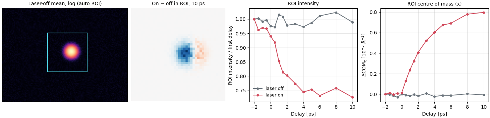

# QoraFlow

QoraFlow reduces pump-probe X-ray diffraction runs from PAL-XFEL. A laser pumps the sample, an
X-ray pulse probes it after a set delay, and the JUNGFRAU detector images, the QBPM
intensity-monitor readings and the laser on/off flags land in HDF5 files. QoraFlow matches those
by timestamp, splits the shots into laser-on and laser-off, applies dark subtraction, QBPM
normalization and LSB quantization, and averages the images per delay into `.npz` and `.mat`
files. A second step measures the ROI intensity and centre of mass of each averaged image as a
function of delay.

The work is done by three scripts run from the repository root, `make_dark.py`,
`integrating_main.py` and `analyzing_main.py`, driven by one `config.yaml`. The library under
`src/QoraFlow` holds the loader, the preprocessors, the integrator and the analyzer they use.



## Install

QoraFlow is installed from a clone with [uv](https://docs.astral.sh/uv/); the README asks for
Python 3.11 to 3.13:

```sh
git clone https://github.com/NaNIsaac/QoraFlow.git
cd QoraFlow
uv sync --python 3.13
uv run pytest -q
```

The scripts import the package from `src/`, so they run with `PYTHONPATH=src` from the repository
root (see the README's [Usage](../README.md#usage)).

## First run

The repository ships no measured data. `examples/synthetic_pump_probe/run.py` writes a synthetic
PAL-XFEL scan whose laser response is known, runs `make_dark.py` and `integrating_main.py` on it
unchanged, measures the ROI with `DataAnalyzer.analyze_by_roi`, and prints what went in next to
what came out:

```sh
PYTHONPATH=src uv run python examples/synthetic_pump_probe/run.py
```

The scan has one Gaussian Bragg peak on a 96 x 128 detector with a dark pedestal, Poisson noise
and 15 % QBPM fluctuations; for delays after zero the laser-on peak loses up to 25 % of its
intensity and moves up to 1.5 pixels along x. After the integration log, the output ends with:

```
 delay ps  ratio in ratio out  dx in px dx out px
     -1.0     1.000     1.000     0.000     0.000
      0.0     1.000     0.987     0.000     0.014
      2.0     0.816     0.798     0.730     0.689
      6.0     0.755     0.739     1.297     1.241
     10.0     0.750     0.743     1.446     1.366
1 px = 2.865e-04 1/Angstrom at the config geometry
```

`ratio` is the laser-on over laser-off ROI intensity and `dx` the shift of the ROI centre of mass
along x between the two, injected and measured. The measured shift is about 5 % low. The images
still carry a flat background after dark subtraction (the synthetic data have a weak uniform
photon floor), and a flat background pulls a centre of mass toward the middle of the ROI
([QoraFlow#28](https://github.com/NaNIsaac/QoraFlow/issues/28)). `analyze_by_roi` can remove it
before the centre of mass is taken; on the same scan, with the default `edge_width` of 3 pixels:

| `background=` | dx at 2 ps | 6 ps | 10 ps |
|---|---:|---:|---:|
| `None` (default) | 0.689 | 1.241 | 1.366 |
| `"edge"` (median of the ROI border) | 0.729 | 1.312 | 1.442 |
| `"plane"` (least-squares plane through the border) | 0.740 | 1.312 | 1.438 |
| injected | 0.730 | 1.297 | 1.446 |

The intensity ratios do not change: the background option applies to the centre of mass only.
The example's [README](../examples/synthetic_pump_probe/README.md) explains what the test around
it checks and its limits.

## Where to go next

- [Reduction pipeline](pipeline.md), on this site: what each step does to the data, in order, from the raw HDF5 files to the ROI table.
- The README's [Usage](../README.md#usage): `config.yaml`, the three scripts, the raw file layout, and the Qt ROI selector.
- [Validation](../README.md#validation) in the README, and the synthetic example above.
- The Python API page lists the public functions and classes of the `QoraFlow` package with their docstrings.
